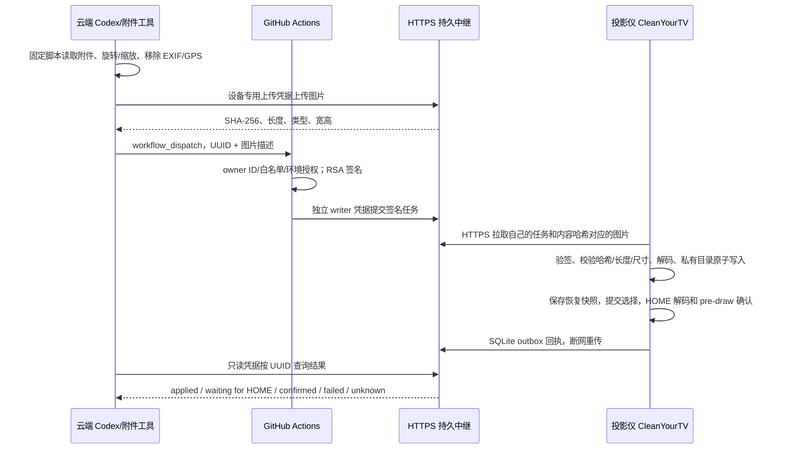

# 壁纸上传、签名更新与部署验收

这次在本地提交 `00b5ec5` 的既有原型上继续开发。当前没有连接家中投影仪，也没有部署公网中继。
先看 [VERIFICATION.md](VERIFICATION.md) 获取实际构建/接口/测试记录；下面的手动步骤尚未执行。

## 1. 已安装 APK 与安全更新

当前云端只有本地构建的 APK，**没有从投影仪提取的 installed-base.apk**。已知本地签名证书 SHA-256 为：

```text
f746475e2a6e5fb26146ee00d03fd274591e190a81965ad16dbce29182debff4
```

这是本地 Android Debug 证书，不代表投影仪已安装 APK 的证书。同叫 Android Debug 也可能是完全不同的密钥。
新远程版和回退版沿用此密钥；与设备是否兼容仍待实际 APK 比对。

在家里的电脑上，用**已本地连接并授权**的 ADB 设备执行只读提取。脚本不扫描、不建立网络连接、不安装、不清数据：

```bash
python3 remote-management/device_audit.py --serial YOUR_LOCAL_ADB_SERIAL --output /private/projector-audit
python3 remote-management/apk_guard.py --installed-apk /private/projector-audit/installed-base.apk --candidate /private/app-remote.apk --build-tools /absolute/android-sdk/build-tools/34.0.0
```

`apk_guard` 验证 Android 9 的 APK 签名、包名、签名证书集合、minSdk 和严格递增的 versionCode。
任意不匹配就退出 2，不提供“先卸载”后门。这个 gate 是保守检查，不自动接受密钥轮换例外。

配置保留依靠**相同包名和相同签名的原位覆盖更新**。代码不执行清数据或破坏性迁移，不碰 `order.txt`、应用库和现有主题。
原 APK 禁止 Android 备份且是非 debuggable 应用时，普通无 Root ADB 无法完整导出私有 preferences/order；
提取 APK 不是完整配置备份，不能把 `adb backup` 空结果当成备份成功。
可额外用现有主题工具在本地备份可读的外部主题目录，但它不包含全部私有设置。

如果签名不一致，必须取得**原始私钥**并在可信构建环境通过安全变量配置；不能从 APK 恢复私钥。
无法取得时保持现有桌面不变，不改包名冒充更新，不卸载重装。
任务通道的 RSA 密钥与 APK 签名 keystore 是两套独立密钥；新生成任务密钥或另一个 debug key 不能修复 APK 签名不兼容。
需要 owner 签名时设置以下安全环境变量，不把值写进 Gradle、Git、Issue、Actions 日志或聊天：
`PROJECTOR_KEYSTORE`（私有路径）、`PROJECTOR_STORE_PASSWORD`、`PROJECTOR_KEY_ALIAS`、`PROJECTOR_KEY_PASSWORD`。

## 2. APK 构建、安装与回退

```bash
cd launcher
./gradlew --no-daemon testReleaseUnitTest lintRelease assembleRelease testRemoteUnitTest lintRemote assembleRemote testRescueUnitTest lintRescue assembleRescue
```

| 构建 | 默认 versionCode | 行为 |
| --- | --- | --- |
| release | 6 | 普通本地启动器，无远程服务或 INTERNET 权限 |
| remote | 7 | 内置远程服务，初次本地配对前不启动远程控制 |
| rescue | 8 | 停用远程服务的前向回退构建；保持同包名、同签名和私有配置 |

产物路径分别为 `launcher/app/build/outputs/apk/{release,remote,rescue}/app-{release,remote,rescue}.apk`。
如果设备版本已经大于等于 7，构建时用 `-PremoteVersionCode=N -PrescueVersionCode=M`，保证 `设备版本 < N < M`。
回退使用更高 versionCode 的 rescue；不使用强制降级、不卸载、不清数据。
rescue 保留已配置的图片与布局，移除远程执行能力；它不是恢复出厂，也不是切换 HOME。
恢复修改前的布局/壁纸另由白名单 `restore_desktop` 完成；快照来自第一次远程修改前，保持不覆盖。

通过实际签名 gate 后，在投影仪文件管理器打开 APK，人工确认“更新”。如出现签名冲突则停止。
这不实现任何远程/静默 APK 安装。**不要运行仓库 `build-and-install.sh`，它含原厂桌面禁用和 HOME 切换步骤。**
回退前先在 Remote 界面 Stop、撤销服务端设备凭据，再用系统安装界面确认同签名 rescue 更新。
本次交付 APK 使用上述本地 debug 密钥；没有实际设备证书匹配结果之前不要安装。

## 3. 任意 JPG/PNG 的通道



输入支持任意文件名的单帧 JPG/PNG，最多 32 MiB、64MP、边长 16384；较大图缩放到 3840×2160 内。
透明 PNG 合成到黑色背景。上传的新图片移除 EXIF/GPS 和其他嵌入元数据。
中继和设备只接受校验后的 JPEG/PNG，最多 8 MiB、边长 4096、总像素 8,388,608；不信文件扩展名或 MIME 自述。
拒绝动画、伪装文件、截断数据和解压炸弹。任务只包含哈希、长度、类型和尺寸，不包含任意 URL、路径或 Shell。

设备图片放在私有 `files/remote-wallpapers`，不会覆盖现有主题图片。配置信息和版本修订一起提交，
HOME 在恢复前台或下一分钟 tick 检查变化并重建；不强行把其他 App 拉到后台。
本地私有图片配额 128 MiB、中继每设备 256 MiB，满时拒绝新图片并保留现状；没有自动删除已有壁纸。
服务端持久保存图片，可以看到内容；这不是端到端加密图片服务，需使用你信任的服务器。

## 4. 部署 HTTPS 持久队列

提供 `wsgi.py`、固定版本依赖、systemd 和 Caddy 配置，适合一台 Linux VPS（建议 Python 3.12、1 vCPU/1 GiB）。
不依赖临时 Actions runner 文件、Artifacts 保留期或临时容器文件系统。

持久数据目录必须是 `/var/lib/cleanyourtv`：`tasks.sqlite`（WAL）以及 `assets/` 的元数据 SQLite 和不可变图片。
重启系统、Gunicorn 或 Caddy 都复用同一目录；磁盘丢失不会凭空恢复，需要保留备份。
生产进程使用单独用户，代码和凭据只读，Gunicorn 只监听 127.0.0.1:8765，由 Caddy 提供公网 HTTPS。
Caddy 配置已用官方二进制完成语法转换检查；Gunicorn 真实启动和持久配置已通过自动测试。
没有为你申请域名、服务器或公网证书。

在可信环境生成部署材料（路径必须在源码 checkout 外，拒绝覆盖已有材料）：
文档中的 `/private/...` 是示例，需替换为你拥有且可写的私有目录。

```bash
python3 remote-management/configure.py --output /private/projector-credentials --broker https://YOUR_DOMAIN --device x5pro
```

| 位置 | 仅放这些材料 |
| --- | --- |
| 服务器 `/etc/cleanyourtv/` | `broker.json` 和 `task-public.pem`，不放签名私钥 |
| GitHub Environment secrets | `task-signing.pem` 内容、writer-token；不进入仓库 |
| 云端 Codex 的安全 Secrets 配置 | Actions PAT、upload-token、reader-token；不放任务签名私钥 |
| 投影仪本地导入 | `pairing.json`，核对公钥指纹后确认；导入后删除共享存储的明文配对文件 |

在你选定的 Ubuntu/Debian 服务器上由管理员完成以下安装；这里的 root 是**云服务器管理权限**，不涉及投影仪 Root：

1. 安装 Python 3.12/venv、OpenSSL、Caddy；创建 `cleanyourtv` 系统用户和组。
2. 把审查后的代码放到 `/opt/cleanyourtv`；代码和 venv 由管理员持有，服务账号只有读取权。
3. 创建 `/opt/cleanyourtv/.venv`，安装 `remote-management/requirements.txt`。
4. `/etc/cleanyourtv` 设为 `root:cleanyourtv`、0750；仅配置和公钥放里面，文件 0640。
   `/var/lib/cleanyourtv` 由服务拥有，0700。不得把私钥/令牌放进代码目录或网页目录。
5. 安装 `deploy/cleanyourtv.service` 到 `/etc/systemd/system/`；daemon-reload，启用并启动服务。
6. 设置 Caddy 服务环境 `PROJECTOR_DOMAIN=你的域名`，将 `deploy/Caddyfile` 安装为其配置；
   在提供商控制台配置域名 A/AAAA 指向这台服务器，放行云服务器的 80/443 以签发/使用证书。
   SSH 仅管理员可达。**不开放 8765，不开放 5555，不修改家中路由器。**
7. 先检查 `https://你的域名/healthz`，再在投影仪验证公开证书链确实受 Android 9 信任；不得关闭 TLS 校验。

图片、数据库和访问凭据只对服务账号/管理员可读，不记录请求体、Authorization 或应用清单。
生产接入仍应设置提供商防火墙、监控磁盘/额度和受控访问限流；示例 Caddy 有 8 MiB 请求体限制，
Gunicorn 有固定 worker、线程和超时；没有宣称部署了分布式 WAF/高可用/防 DDoS 服务。
备份时短暂停止中继，备份完整数据目录和相应配置，随后启动；备份需加密并限制访问，不能放 GitHub。
设备保持本地 journal，即使旧备份导致任务重投也重传缓存结果而不重复执行。

成本（2026-10-21 查询）：[DigitalOcean 官方价目](https://www.digitalocean.com/pricing/droplets) 的 Basic
1 GiB/1 vCPU/25 GiB 磁盘/1000 GiB 流量为 **US$6/月**，512 MiB 起价 $4/月，建议用 1 GiB 给图片解码留余量。
域名按注册商另计，预算约 $10–20/年（估算，不是报价）；已有服务器和域名可复用，增加成本主要是资源占用。
Caddy/ACME TLS 无证书购买费用；备份、税费、额外流量和 Actions 超额计费另算，未替你创建任何付费资源。

## 5. GitHub Actions 403：最小权限修复路径

本次实际触发现有 CI 的 REST POST 再次返回 `403 Resource not accessible by integration`。
“已登录”和仓库 metadata 显示 admin 不证明集成令牌有 Actions 写权限。
改工作流里的 `permissions: write-all` 不能补充外部 Codex 凭据的权限，也不应这么做。

最小运行凭据：由 owner 创建 fine-grained PAT，只选 `himoggyi/cleanyourtv`，只授予 **Actions: Read and write**，
Metadata read 为 GitHub 自动必需项；不需要 Contents write、Administration 或经典 `repo` 全仓权限。
设置短有效期，按需审批后，通过云环境的安全 Secret 界面设置 `PROJECTOR_GITHUB_TOKEN`。
这是账户授权，当前集成不能自行提升此权限；不要把 PAT 发在聊天、Issue、代码或截图里。
官方依据：[workflow dispatch 所需权限](https://docs.github.com/en/rest/actions/workflows#create-a-workflow-dispatch-event)。

部署代码/工作流是另一个一次性动作：owner 可在自己的本地 Git 环境应用交付补丁并审查合并到 main。
若要使用另一个自动发布凭据，它需要单仓库 Contents/Workflows 写权限；**不要把这两个权限加到长期任务 PAT 上**。
当前工作流仍是 `.yml.example`，审核后放到 main 的 `.github/workflows/projector-relay.yml` 才能被 dispatch。
保护 main；工作流 checkout 固定 main，关闭持久 Git 凭据，任务正文从 event JSON 读取，不插入 Shell。

创建受限到 main 的 `projector-control` Environment，设置 required reviewers，并配置：
`PROJECTOR_TASK_SIGNING_KEY`、`PROJECTOR_BROKER_WRITER_TOKEN` 为 Secrets，`PROJECTOR_BROKER_URL` 为非秘密变量。
首次可维持每任务审核，先跑通 status 和壁纸真机验收。

以后只说“换成这张壁纸”就自动执行，需要 owner **一次性明确授权**：创建仅受 main 分支保护的
`projector-wallpaper` Environment，配置同样的签名/写入 Secrets 和 broker URL，允许这项壁纸委托无需逐次人工审核；
设置仓库变量 `PROJECTOR_AUTOMATIC_WALLPAPER=true`。
工作流只有 `apply_wallpaper` 会选择这个环境，签名前也设置/检查 `ALLOWED_OPERATION=apply_wallpaper`。
其他操作继续进入 `projector-control` 审核；不扩大为任意 Shell、应用安装或系统管理授权。
如果套餐或组织策略无法强制保护环境/分支，应保留人工审核，不把缺失的保护当作已生效。

云端另安全设置：`PROJECTOR_BROKER_URL`、`PROJECTOR_UPLOAD_TOKEN`、`PROJECTOR_READER_TOKEN`。
写入、读取、上传、设备四类凭据全部隔离；上传不能执行任务，reader 不能提交任务，writer 不能读取回执。
签名私钥只交给受保护的 GitHub Environment；不放在云端日常聊天执行环境或投影仪。

```bash
python3 remote-management/dispatch.py --probe
python3 remote-management/github_access.py --dispatch-status
```

第一条仅证明读取，不能宣称 Actions 写权限已验证。第二条在中继和配对准备好之后才实际提交无害 status，
检查 Actions run、入队和设备回执才能确认链路。403 未真正消失前不能报告“权限已解决”。

## 6. 真机端到端验收

自动化测试已经覆盖真实 TLS 下的上传、签名、校验、下载、持久化和回执，但设备侧明确是模拟，
不能替代双幻 X5 Pro 实机。真实验收前需要完成签名更新、部署、外部权限和本地配对。
在 Remote 界面导入配对文件，核对 broker 域名和 RSA 公钥指纹后 Authorize；设备 token 使用 Android Keystore 加密。
先运行 status 核对 SDK=28 和型号，再使用你选定的一张真实 JPG/PNG：

```bash
python3 remote-management/wallpaper.py --image /absolute/your-attachment.png --device x5pro --wait-seconds 600
```

脚本不会持有签名私钥。它自动处理图片、上传、Actions dispatch，并用 UUID 查询该任务的回执；
没有配置四项云端凭据时，不发送网络请求。照片名不进入 Shell 或任务路径。
输入是原图，回执比较的是已归一化图片的 SHA-256；原图 EXIF/尺寸改变后哈希本就不同。

只有 task ID、设备和哈希一致，`status=succeeded`、`applied=true`、`display_confirmed=true`、
`evidence=image_view_pre_draw` 且不是模拟结果，客户端才确认桌面已解码并准备绘制。
这个证据不是投影光学画面或硬件远程证明；最终由你看一眼画面确认方向/裁切是否符合预期。
投影仪在别的 App 中时，会先应用设置并返回等待 HOME；不抢占当前 App。返回 HOME 后可用 status 查询
`display_revision`/`display_file` 对照同一 UUID/哈希。

任务排队、审核、网络和服务调度无实时保证，设备正常轮询约 60 秒，桌面刷新还可能等下一分钟 tick。
图片落盘后最多等 75 秒获取 frame-ready 证据；超时不冒称已显示。
客户端超时不是取消：原 Actions run 仍可能在待审核，保留 UUID 检查并按需在 GitHub 取消；不要盲目重发。
断网后回执重传；执行中杀进程标 unknown，不自动重复副作用。force-stop 后可能要手动 Resume。
验收还应测断网/重启、错误签名/错误哈希、恢复快照和 Stop/令牌撤销；没有真机数据前这些均列为待验收。

后续聊天遵循 [CHAT-CONTROL.md](CHAT-CONTROL.md)，根目录 `AGENTS.md` 会引导 Codex 读取它。
这不是已经安装的独立 MCP 服务或永久后台聊天监听器；新会话仍需要可用执行工作区、附件和安全凭据。

## 需要 owner 一次性完成的事项（集中清单）

1. 本地只读提取实际已安装 APK，运行签名 gate；不匹配时通过安全构建配置提供原始签名密钥，找不到就不更新。
2. 选定/授权服务器与域名预算，部署 systemd+Caddy+持久目录，安全分发四类凭据与公钥。
3. 由 owner 审查发布代码/工作流，配置单仓库 Actions PAT 和受保护的 Environment；可明确启用仅壁纸自动委托。
4. 通过 gate 后在投影仪上人工确认更新，导入配对并核对指纹；完成一次真实壁纸和恢复测试。

这些步骤当前都不能根据代码/本地模拟测试自动认定成功。之后 Codex 才能在已配置会话中直接处理壁纸附件。
