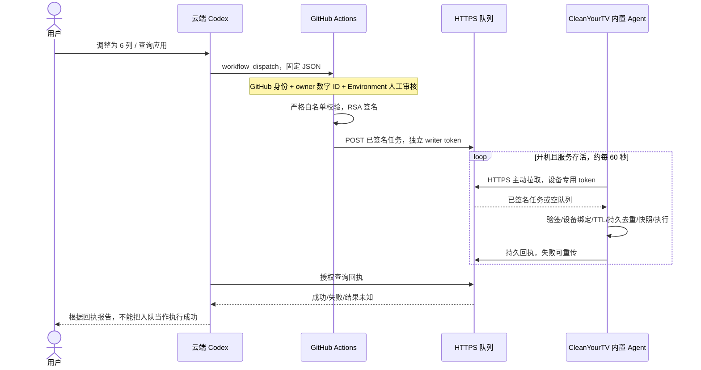

# 云端 Codex → Android 9 投影仪：架构与最小原型

本原型针对双幻 X5 Pro / Android 9，基于仓库提交
`a6996036102f9c84f1f6e19ac51164fa1e83a30c`。**没有连接或操作真实投影仪，尚不能声称已实现聊天控制真机。**

执行端位于 `launcher/app/src/remote/`，只包含在显式 `remote` 构建中。普通 `release` 沿用原有本地模式
和 420 KiB 体积门槛；远程版使用相同 applicationId，后续经签名核对和本地授权才可作为启动器更新。
构建命令（仅构建，不安装）：

```bash
cd launcher
./gradlew --no-daemon testReleaseUnitTest lintRelease assembleRelease testRemoteUnitTest lintRemote assembleRemote
```

远程产物为 `launcher/app/build/outputs/apk/remote/app-remote.apk`，使用现有 debug 签名机制，不自动作为可信正式发布。

## 当前接口验证（2026-10-21）

| 层次 | 实际观察 | 结论 |
| --- | --- | --- |
| GitHub 连接器 | 能读取 `himoggyi/cleanyourtv`；认证用户 ID `143339177`；提供创建 Issue 工具 | 可访问仓库；工具清单里没有 workflow/repository dispatch |
| 云端命令行 | 开放命令的网络权限后，`gh auth status` 成功；REST 能读取现有 CI 工作流 | 有实际 HTTP/CLI 接口；首次沙箱失败不能作为令牌失效证据 |
| Actions 写权限 | 实际 POST 现有 `ci.yml/dispatches` 返回 403 `Resource not accessible by integration`；没有 run 被创建 | 当前不能从此会话触发 Actions；见 `VERIFICATION.md` |
| 设备通道 | 未配置 HTTPS broker、设备配对和签名密钥；未连接家庭网络 | 无端到端真机证据 |

`dispatch.py --probe` 是只读检查，输出明确标记写权限未证明。它使用未来单独配置的
`PROJECTOR_GITHUB_TOKEN`，不依赖某一次 Codex 会话的隐含凭据。当前已认证 `gh` 有可用 REST
网络通道，但实际 dispatch 权限被拒绝；以后需安全配置具备该仓库 Actions:write 的凭据或调整 GitHub App 授权，再重新验证。
同样，实际 Git push 和连接器 create-branch 都被 403 拒绝；本地分支并未发布到 GitHub。
不在聊天中索要或粘贴 PAT；通过云环境的安全 Secret 配置注入。

## 推荐架构



投影仪只发起出站 HTTPS 443；不需要路由器端口映射、刷机或 Root。远程通道不使用 ADB。
无线 ADB 可仅用于首次本地安装，接受设备 RSA 授权后安装经过校验的构建；完成后关闭 ADB。
**禁止将 5555 暴露公网。** 也不让 GitHub 托管 runner 直连家庭 ADB，不在家中运行能执行仓库代码的通用 self-hosted runner。

选择内置 Agent 是因为仓库的 `Config`/`Order` 和本地壁纸选择属于启动器私有状态。
现有 `ThemeProvider` 受 `WRITE_SECURE_SETTINGS` 保护；不能假设独立 App 能调用它。
本原型在启动器同一应用中通过 Android API 写入有限设置，完全不执行 Shell。

## GitHub Actions 可行性、延迟、权限

Actions 适合作为低频、可审计的任务授权和签名中继。它不是消息队列，也不是长期在线服务。
本方案另有小型持久 broker；**不是只靠 GitHub 就能完成常驻执行**。

延迟预算是 GitHub 排队/runner 启动 + 人工审核 + 签名/HTTP + 设备 0–60 秒轮询等待。
可把无审核、网络正常时约几十秒到数分钟作为规划估算，**不是本项目实测，也没有 SLA**。
拥堵、额度耗尽、断网、休眠和系统杀进程可能造成长时间延迟；原型任务签名后 30 分钟过期，禁止补执行过期任务。
布局/壁纸设置写入后的可见刷新，还可能等待桌面下一次分钟 tick，或在返回 HOME 时立即检查。
Environment 审核无固定等待上限。采用事件触发，不采用 cron；定时 Actions 最短通常为 5 分钟且可能延迟或丢弃。

| 入口/权限 | 用途与限制 |
| --- | --- |
| `workflow_dispatch` + fine-grained Actions:write | 推荐，固定工作流和 main；工作流必须已在默认分支存在 |
| `repository_dispatch` + Contents:write | 可行但仓库写权限更广，原型不实现 |
| 创建 Issue / 评论事件 | 连接器有此类入口，但未验证事件归属与触发链；公开仓库会泄露任务内容，不作为原型安全通道 |
| 工作流 `GITHUB_TOKEN` | 仅 Contents:read；不是从外部 Codex 登录的凭据，也不是家庭访问凭据 |
| 普通 App 或 PAT | 权限需单独配置，不能从“GitHub 已连接”推断全部 REST 写权限 |

GitHub 的 `GITHUB_TOKEN` 对事件递归触发有限制；不能假设用它创建 Issue 会触发中继。
Actions 分钟数、并发数、网络可用性和 Environment 审核能力依账号/套餐和仓库策略而定。
公有源码仓库不会隐藏代码；不要把 token、私钥、家庭 IP、应用清单或配对文件提交到仓库/Issue/日志/Artifacts。

GitHub-only 备选：Actions 上传签名任务 Artifact，设备用 Actions:read 轮询下载。
它需要在设备保存 GitHub 凭据，还要处理 artifact 过期、分页、下载重定向以及独立回执；不适合作为可靠状态队列，故未实现。
若以后有可调用的自定义 MCP/HTTPS 工具，可让 Codex 直接访问带认证的 broker，绕过 runner 启动延迟；当前不假设有这个接口。

官方依据：[事件与触发限制](https://docs.github.com/en/actions/reference/workflows-and-actions/events-that-trigger-workflows)、
[workflow dispatch 权限](https://docs.github.com/en/rest/actions/workflows#create-a-workflow-dispatch-event)、
[repository dispatch 权限](https://docs.github.com/en/rest/repos/repos#create-a-repository-dispatch-event)、
[Environment 审核](https://docs.github.com/en/actions/reference/workflows-and-actions/deployments-and-environments)。

## 安全边界与白名单

任务内容只允许 `v,id,device,issued_at,expires_at,op,args`。RSA-2048 或更强、SHA256withRSA，
签名覆盖原始 UTF-8 payload 的全部字节；payload/signature 用 Base64 封装，避免跨语言 JSON 序列化差异。
签名密钥只在受保护的 Actions Environment；broker 与设备只保留公钥。
设备配对界面显示公钥 SHA-256 指纹，由本地用户对照确认；token 通过 Android Keystore AES-GCM 加密保存，应用禁止备份。
broker writer token 和每个设备 token 必须分别随机生成，互不相同。设备 token 只能拉取自身任务和提交自身回执。
HTTPS 校验证书，拒绝重定向、明文 URL；任务不可修改 broker、token、公钥、下载地址或执行程序。

| 操作 | 原型行为 |
| --- | --- |
| `status` | Android SDK/型号及能力状态 |
| `list_apps` | 查询最多 60 个可见包名，明确可能截断；不卸载/禁用/清数据 |
| `set_layout` | 只改列数 4–7、dock 下行数 0–3；返回 HOME 或其下一次分钟 tick 重建桌面；不改任意 config.json 或 tile 排序文件 |
| `set_wallpaper` | 只选已在启动器 `wallpapers/` 中的安全文件名；拒绝路径、URL和 Shell 字符；不是系统 WallpaperManager 壁纸 |
| `restore_desktop` | 恢复远程首次修改前的上述布局/壁纸选择快照；不是恢复出厂或切换系统 HOME |
| `install_apk`、Shell、卸载、禁用、重启等 | 在中继和设备均拒绝 |

本原型将每个任务都放到 `projector-control` Environment 人工审核后再签名。
首次本地配对仅开启这份白名单，不会授权任意 Shell。
需要保护 main 分支、限制 Environment 到 main、设置 required reviewers，再启用工作流；防止攻击者改签名代码。
仓库管理员和签名 Environment 管理员是信任根；这套机制不能防御已被完全接管的 GitHub 管理员。
如套餐无法强制审核，不得把这个示例当作具有逐次审核能力的已部署方案。

broker 被盗的 writer token 不能伪造签名，但能查询回执；设备 token 被盗可伪造该设备回执/阻塞队列。
因此回执是基于设备凭据的执行报告，不是硬件证明。生产部署还需限流、配额、监控、密钥轮换和数据库备份。
固定 broker 使用系统信任 TLS；任务签名提供额外完整性，未实现 TLS SPKI pinning。

SQLite 在副作用前持久记录任务 ID；完成结果存在本地 outbox，断网重传。
进程在执行中断掉，重启后标为 `unknown`，不自动重复副作用；需要检查设备再决定是否重新授权新 ID。
不是“恰好一次执行”的保证。broker 不在过期后下发，回执可在过期后重传。
本地 journal 保留 ID 防重放，生产版需要有保留窗口的维护策略；原型未实现自动清理。

## APK 安装授权的后续协议（当前关闭）

“安装 VLC”应先解析成可信目录条目，例如固定 `org.videolan.vlc` 的版本与 ABI；不能把聊天里的任意 URL 当安装源。
目录应绑定官方 HTTPS 发布来源、版本、文件 SHA-256、包名、签名证书 SHA-256、ABI、最低 SDK 和大小上限，
目录本身需要版本化签名和回滚保护。初始证书指纹通过独立可信来源建立，不从同一下载响应直接信任。
Android 9 需要选兼容的 SDK/ABI；从设备读取实际 ABI，不能根据型号猜测。

安全顺序：下载到私有暂存区（严格域名/跳转限制、大小和超时限制）→ Android 验证 APK 签名和包信息 →
核对官方目录证书/内容哈希/版本 → 展示包名、版本、来源、证书、SHA-256 → 用户逐次确认 →
生成绑定 task ID、设备、APK 哈希、证书和有效期的一次性授权 → 安装前重新校验相同字节。
不允许先安装再检查来源；不允许对所有未来版本泛化授权。

无 Root/Device Owner 的普通 Android 9 App 不能保证静默安装。应使用 PackageInstaller 并处理
`STATUS_PENDING_USER_ACTION`，让用户在投影仪系统界面确认和允许该来源安装。
聊天授权不能绕过系统安装确认；可辅助自动下载和校验。不要为追求静默安装自动获取 Device Owner 或 Root。
备用本地 ADB bridge 可在另行授权后做固定 `install` 操作，但这增加家庭常驻设备与高权限凭据，本原型未实现。
当前代码没有 APK 下载/安装入口，因此这部分是设计，不能报告“VLC 已安装”。

## Android 9 服务恢复与实际限制

用户在 Remote 配对界面确认后启动前台服务，几秒内显示常驻通知；每约 60 秒主动拉取。
断线指数退避到 15 分钟，成功恢复到 60 秒。`START_STICKY`、`BOOT_COMPLETED` 和持久
JobScheduler 15 分钟恢复机会共同使用；任务 outbox 和 ID journal 在私有 SQLite 中。
恢复服务不是 Android 的实时保证：Doze、厂商省电和网络限制可以推迟 JobScheduler；
用户 force-stop 后不能保证自动重启，需要再次手动打开 Remote 界面并 Resume。
不通过无障碍、保活漏洞、循环唤醒屏幕或自动关闭系统组件绕过用户停止行为。

本地用户需允许开机启动、在厂商设置中按需允许后台运行/取消该应用电池优化；不自动修改这些设置。
首次验收需校准设备系统时间；时钟异常会拒绝任务，不通过扩大签名有效期来掩盖问题。
设备被断电时无法执行。Android 9 是本次兼容目标；Android 12+ / 14+ 的前台启动限制需要另行适配。
官方参考：[Android 9 前台服务权限](https://developer.android.com/develop/background-work/services/fgs/changes)、
[后台前台服务限制](https://developer.android.com/develop/background-work/services/fgs/restrictions-bg-start)。

## 本地验证，不需要投影仪

依赖 Python 3.12、OpenSSL 和允许 loopback socket 的运行权限：

```bash
python3 -m unittest discover -s remote-management -p 'test_*.py' -v
```

测试临时生成 RSA 密钥，验证签名篡改、设备绑定、TTL、未知字段、路径/命令注入、权限隔离、
SQLite 重开、重复 ID 和不可变回执，并在 loopback 做签名提交 → 拉取 → 模拟结果 → 回执查询。
模拟结果明确标记 `simulated`，不是 Android 设备测试，也不证明 Android native journal 已通过杀进程测试。

`broker.py` 只监听 127.0.0.1，Python HTTPServer 不是生产公网服务。
正式部署需在你控制的服务器用反向代理提供合法 HTTPS 证书、连接/请求体/速率限制；
私有数据库卷、0600 配置、最小权限服务用户、重启策略；仅把 HTTPS 443 暴露给 Actions 和设备。
本原型不自动部署公网服务器、不创建付费资源。

broker 私有配置格式（下列占位符不可直接使用）：

```json
{"writer_token":"RANDOM_BASE64URL_32_BYTES_OR_MORE","devices":{"x5pro":"DIFFERENT_RANDOM_BASE64URL_32_BYTES_OR_MORE"},"public_key":"/absolute/private/config/task-public.pem"}
```

用 `openssl genpkey -algorithm RSA -pkeyopt rsa_keygen_bits:3072` 在可信环境生成私钥，并用
`openssl pkey -pubout` 导出公钥。私钥只交给受保护的 Actions Environment，不交给 broker 或设备。
签名 key 的输入/输出文件用 0600 且不入 Git。公钥虽然不保密，仍需要可信分发。

```bash
python3 remote-management/broker.py --config /private/broker.json --db /private/runtime/tasks.sqlite
```

设备配对文件格式：

```json
{"device":"x5pro","broker":"https://YOUR-BROKER","token":"DEVICE_SPECIFIC_RANDOM_BASE64URL_TOKEN","public_key":"-----BEGIN PUBLIC KEY-----\n...\n-----END PUBLIC KEY-----"}
```

本地打开 `CleanYourTV Remote (prototype)` → 导入配对文件 → 核对 broker 和公钥指纹 → Authorize。
不要使用网页或未知 Intent 自动传入配对配置。配对 JSON 本身含 token，导入后从共享存储中删除；
泄漏时旋转设备 token 并重新本地配对。通知点按可回到停用界面；本地 Stop 与服务端 token 撤销分别处理。
卸载/重装会失去本地去重记录，需要撤销旧凭据并清空旧队列，再生成新 device ID 配对。

## 启用顺序与真机验收

1. 在隔离分支审查代码，完成现有 Android CI 的编译、lint、测试及 APK 大小检查。release 构建现在使用仓库的 debug 签名机制，**不能自动视作可信发布**。
2. 比较家中已安装 CleanYourTV 的证书与待安装构建；签名不一致不可覆盖更新，不自动卸载旧启动器。
   为正式渠道建立稳定的 owner release key；不要上传工作站 debug keystore。核对构建哈希后才由你授权本地安装。
   此次不要运行 `build-and-install.sh`：原有脚本包含 HOME 切换和 stock launcher 禁用步骤，超出了本次原型的授权范围。
3. 准备 HTTPS broker、随机且隔离的 token、公钥和 Environment 签名私钥。保护 main 和 Environment。
4. 审核后把 `actions-relay.yml.example` 放到默认分支 `.github/workflows/projector-relay.yml`。
   当前示例文件不会触发任务，也没有安装/卸载操作。
5. 云环境安全注入仅该仓库 Actions:write 凭据。先 read-only probe，再真实 dispatch `status` 并确认 Actions run 和 broker 回执。
6. 首次本地导入配对后，仅运行 status/list_apps；确认 SDK=28 和设备型号，再测试重启、断网和手动停止。
7. 本地暂存一张已校验的壁纸到 CleanYourTV collection（可使用仓库本地 theme 工具）；发送白名单文件名。
   测试布局、返回 HOME 或下一分钟 tick 显示、快照恢复。不把新壁纸下载能力误报成已实现。
8. 在副作用前/后杀进程并重启：同 ID 不重复执行，回执为 unknown 或缓存结果；队列/SQLite 故障不能报成功。
9. APK 先保持关闭。只有可信目录/签名/哈希/逐次授权/系统安装确认的真机验收完成后，才新增这一白名单操作。

未来已部署后，安全发送示例：

```bash
python3 remote-management/dispatch.py --probe
python3 remote-management/dispatch.py --task '{"device":"x5pro","op":"set_layout","args":{"columns":6,"rows_below_dock":1}}'
```

这份原型已覆盖可审查的架构、发送器、签名中继、持久 broker、设备执行服务源码和无设备测试。
未经 `VERIFICATION.md` 明确记录的步骤均不应视为完成。生产 TLS 部署、设备证书核对/安装、配对及真机恢复测试仍是后续验收工作。
